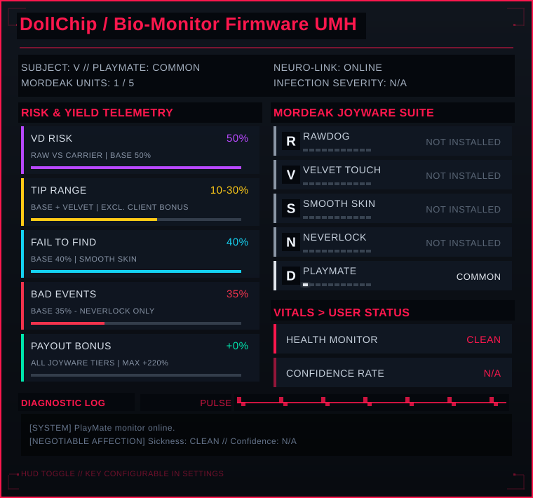

# Mordeak Technica - Joyware Line

Mordeak Technica adds five upgradeable cyberware items and a configurable DollChip HUD to Cyberpunk 2077.

## Cyberware features

| Cyberware | Slot | Features |
| --- | --- | --- |
| DollChip | Operating System | Reduces quickhack upload time, with additional Intelligence scaling. Unlocks the DollChip HUD. |
| RawDog | Circulatory System | Adds health, out-of-combat health regeneration, and thermal and chemical resistance. |
| Velvet Touch | Hands | Improves stealth and stealth throwing damage, reduces enemy detection speed, and adds Cool-scaled headshot damage. |
| SmoothSkin | Integumentary System | Adds armor, physical resistance, and mitigation chance, with additional Body-scaled armor. |
| NeverLock | Eyes | Provides optics features, delays hostile quickhacks, enables quickhack critical hits, and adds Intelligence-scaled quickhack damage. |

Cyberware is available from selected ripperdocs, with stock and tier availability varying by vendor and player level. Each item can be upgraded from Common through Legendary++.

DollChip awards attribute and perk points as new highest tiers are reached. The points are awarded only once per tier progression; removing and reinstalling an already-awarded tier does not award them again. Cyberware-EX adds an additional operating system slot unlocked by the Optimization perk.

## DollChip HUD

Equip DollChip and press **Y** by default to show or hide the HUD. The HUD displays installed Joyware tiers and, when Negotiable Affection is installed, related telemetry and sickness information. It cannot open during combat or dialogue and closes when either begins or DollChip is removed.

When infection is detected, the HUD displays a red **TRAUMA ALERT** on a black background.

The diagnostic log includes a scrolling pulse trace showing approximately 6.4 seconds of recent beats. It speeds up with Negotiable Affection's sickness counter, from one beat per second at zero to one every 0.4 seconds at 20 or above. It shows offline if Negotiable Affection is absent and unavailable if its sickness data cannot be read. Headings and the status summary have dark backgrounds for readability, and heading and pulse text use white when the HUD color is black. The pulse is an indicator, not a measured heart rate.

## Settings

Open the Redscript Configuration Framework hub (default **F8**) and select **Mordeak Technica**. In-game, the settings popup includes a live HUD preview with sample data.

| Setting | Options | Default |
| --- | --- | --- |
| HUD Color | Red, Yellow, Blue, Pink, Black | Red |
| Background Color | Red, Yellow, Blue, Pink, Black | Black |
| Background Opacity | 0-100%; 0 is transparent and 100 is opaque | 100% |
| HUD Toggle Key | Choose a keyboard key | Y |

Click the controls or use the arrow keys / D-pad to select and adjust settings. To rebind the HUD key, select **HUD Toggle Key**, press Enter or the gamepad select button, then press the desired keyboard key. Press Escape or the gamepad back button to cancel; capture also times out after five seconds. **Reset** restores the saved defaults, and **Done** closes the popup.

## Requirements and compatibility

- RED4ext, redscript, Codeware, ArchiveXL, TweakXL, Input Loader, Cyberware-EX, and Redscript Configuration Framework, including its required dependencies.
- Negotiable Affection is optional; its telemetry is shown as offline when it is not installed.
- Night Vision is optional; NeverLock has Night Vision support for Kiroshi Optics Night Vision Mod.
